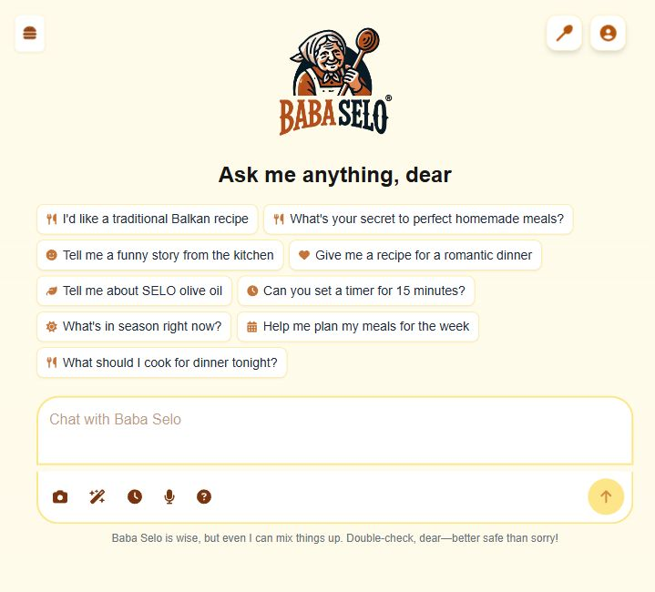
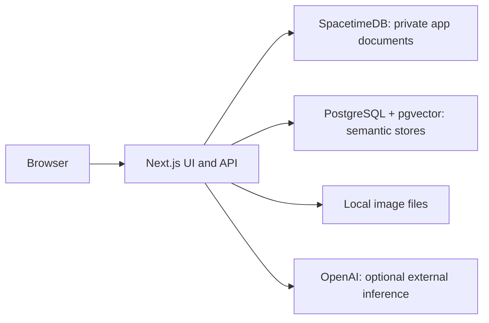

# Baba Selo

A local-first AI cooking companion for Balkan recipes and meal planning. Built with Next.js, LangChain/LangGraph, SpacetimeDB, and PostgreSQL/pgvector. Licensed under [MIT](LICENSE).



## Quick start

Install **Node.js 22+** and [SpacetimeDB 2.10.2](https://spacetimedb.com/install). Docker is optional.

```sh
npm ci
```

Copy [`.env.example`](.env.example) to `.env.local`. Add `OPENAI_API_KEY` if you want AI features, then:

```sh
npm run dev
```

Open **[127.0.0.1:3001/login](http://127.0.0.1:3001/login)** and choose **Continue as local developer**. Startup launches the databases, builds the database module, and seeds a developer account and three original sample recipes. First startup also installs the module's pinned dependencies.

You can browse, save and edit recipes, upload images, and inspect the architecture without an AI key. Chat, generation, semantic search, image generation, and transcription use OpenAI and require your own key; provider charges apply. No model or private recipe corpus is bundled.

## What you can explore

- **Recipe chat:** a LangGraph ReAct agent with 14 structured LangChain tools for recipes, substitutions, servings, timers, nutrition, and meal plans.
- **Recipe generation:** a graph that checks semantic caches, retrieves recipe context, generates a recipe, and enriches the result.
- **Recipes and meal plans:** local collections, profiles, saved chats, recipe uploads, meal history, and shopping lists.
- **[Admin AI explorer](http://127.0.0.1:3001/admin/ai):** actual compiled graph topology, clickable node explanations, registered tools, model settings, and live backend health. This view does not call OpenAI.

## Local architecture



The default PostgreSQL runtime is **[PGlite](https://pglite.dev/)**, a WebAssembly build of PostgreSQL with pgvector exposed through the PostgreSQL wire protocol. For a regular PostgreSQL server with pgvector installed, set `LOCAL_POSTGRES_URL` in `.env.local`. The app uses the same SQL and LangChain queries with either runtime.

| Service | Default address | Data |
| --- | --- | --- |
| Next.js | `127.0.0.1:3001` | Application UI and API |
| SpacetimeDB | `127.0.0.1:3100` | `.local/spacetimedb` |
| PostgreSQL/pgvector | `127.0.0.1:5433` | `.local/postgres` with PGlite |
| Image storage | Served by Next.js | `.local/uploads` |

Everything under `.local/` is private runtime state and ignored by Git. Restarting preserves your data. The sample developer has admin and Pro access, so local use does not require checkout.

**This distribution runs as a single-developer app on loopback.** The bundled sign-in is intended for local development. Public hosting requires a separate authentication and authorization design; do not expose the local developer account through a public tunnel. PGlite is a development runtime with one PostgreSQL backend that multiplexes connections.

## Commands

| Command | Purpose |
| --- | --- |
| `npm run dev` | Start the local stack and development server |
| `npm run build` | Build the Next.js app |
| `npm start` | Start the local stack and serve an existing production build |
| `npm run typecheck` | Check app and script types |
| `npm test` | Run offline unit and repository checks |
| `npm run test:integration` | Test the running local backend and pgvector |
| `npm run sync:recipes -- --dry-run` | Count saved recipes without requesting embeddings |
| `npm run sync:recipes` | Index saved recipes using your OpenAI embedding key |

Use Ctrl+C to stop services started by the launcher. Services that were already running are left alone. See [local development](docs/LOCAL_DEVELOPMENT.md) for native executables, ports, optional Docker, external databases, and troubleshooting.

## Repository guide

```text
app/
  admin/ai/             AI architecture explorer
  api/                  Next.js API routes
  lib/backend/          Sessions, documents, timestamps, and local files
  lib/chatGraph.ts      ReAct chat orchestration
  lib/recipeGraph.ts    Recipe generation graph
  lib/stores/           Semantic caches, retrieval, memory, and recipe index
scripts/local/          Service startup, original fixtures, and tests
spacetimedb/src/        Private document tables and transactional reducer
docs/                  Setup and architecture documentation
```

Model names are centralized in [`app/lib/models.ts`](app/lib/models.ts). Read the [AI architecture notes](docs/LANGCHAIN_VECTOR_CACHE_ARCHITECTURE.md) for routing, cache thresholds, and retrieval behavior.

Optional payment, email, and voice-history integrations remain in the source as extension examples. The default local launcher disables payment, email, and cron credentials. They are not needed for the local app and are not configured by this quick start.

## Contributing and license

See [CONTRIBUTING.md](CONTRIBUTING.md) for the development workflow and [SECURITY.md](SECURITY.md) for reporting vulnerabilities. Never include credentials, database snapshots, user uploads, or private corpus data in an issue or pull request.

The application source and original sample fixtures are distributed under the [MIT License](LICENSE). Dependencies retain their own licenses, including SpacetimeDB's upstream licensing terms. Private scraping scripts and ingested datasets are not distributed.
