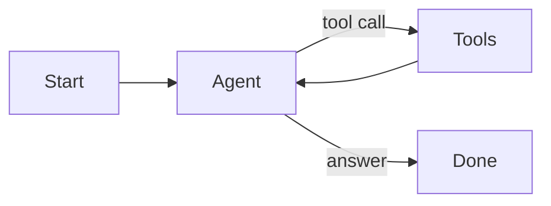
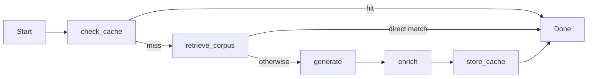

# AI architecture

The `/admin/ai` explorer reads the application's compiled LangGraph graphs and registered LangChain tools. Its node explanations describe the source implementation; the diagram is architecture, not live execution telemetry. Inspecting it does not call an AI provider.

## Chat

`app/api/chat/route.ts` validates messages, resolves a signed local session, and assembles the system prompt. For recipe-related messages it can retrieve corpus context; Pro users can also retrieve past conversation turns.

`app/lib/chatGraph.ts` creates a LangGraph ReAct agent with `ChatOpenAI` and tools from `chatToolsLangchain.ts`. Each tool uses a Zod argument schema and calls the application's existing handlers. The agent can loop through tools before returning its final response.

There are 14 registered tools: image generation, recipe saving, similar recipes, serving conversion, nutrition, substitution, timers, translation, today's meals, meal-plan generation, adding a meal, seasonal tips, ingredient search, and unit conversion. Meal-plan generation emits custom progress events for the UI. Some supporting handlers call the OpenAI SDK directly.

## Recipe pipeline

`app/lib/recipeGraph.ts` uses a `StateGraph` with explicit conditional destinations, so graph introspection shows only possible routes.

Generation returns validated JSON ingredient and direction arrays. When `generateAll` is true, enrichment classifies the recipe, writes a summary, then requests macros and pairings in parallel. `skipMacroAndPairing` omits those two requests. Complete newly generated recipes can then be cached. A cached recipe or direct corpus match ends the graph before generation and enrichment.

## Semantic stores

All stores use LangChain's PostgreSQL vector integration and cosine distance, where smaller values indicate closer matches. The default embedding model is `text-embedding-3-small`; model names live in `app/lib/models.ts`.

| Table | Purpose | Retrieval rule |
| --- | --- | --- |
| `recipe_embeddings` | Complete generated recipes | Distance ≤ 0.12 |
| `enrichment_cache` | Classification, summary, macros, pairings | Distance ≤ 0.08; filter by type |
| `balkan_recipe_corpus` | Recipe retrieval and generation context | < 0.1 returns directly; up to 3 matches < 0.3 provide context |
| `conversation_memory` | Pro conversation recall | Distance ≤ 0.35; filter by user |
| `recipe_index` | Similar saved recipes | Cosine ranking with duplicate/source exclusion |

Cache hits avoid generation calls, but semantic lookup may still request an embedding. There is no fixed latency guarantee. A fresh installation starts with empty semantic stores and no private corpus. Recipes saved through the app are indexed; `npm run sync:recipes` can index the full local collection.

## Application state

SpacetimeDB holds private document rows keyed by collection/document paths. The Next.js server reads with the database owner's credential, which never reaches the browser. Writes and field transforms run in a transactional reducer. The client document API in `app/lib/backend/database.ts` handles queries, pagination, batches, and polling subscriptions.

PostgreSQL holds embeddings and metadata. Local images are ordinary files under `.local/uploads`, served by same-origin API routes. Local HMAC sessions identify the single developer account. See [local development](LOCAL_DEVELOPMENT.md) and [security](../SECURITY.md) for the runtime and trust boundary.
